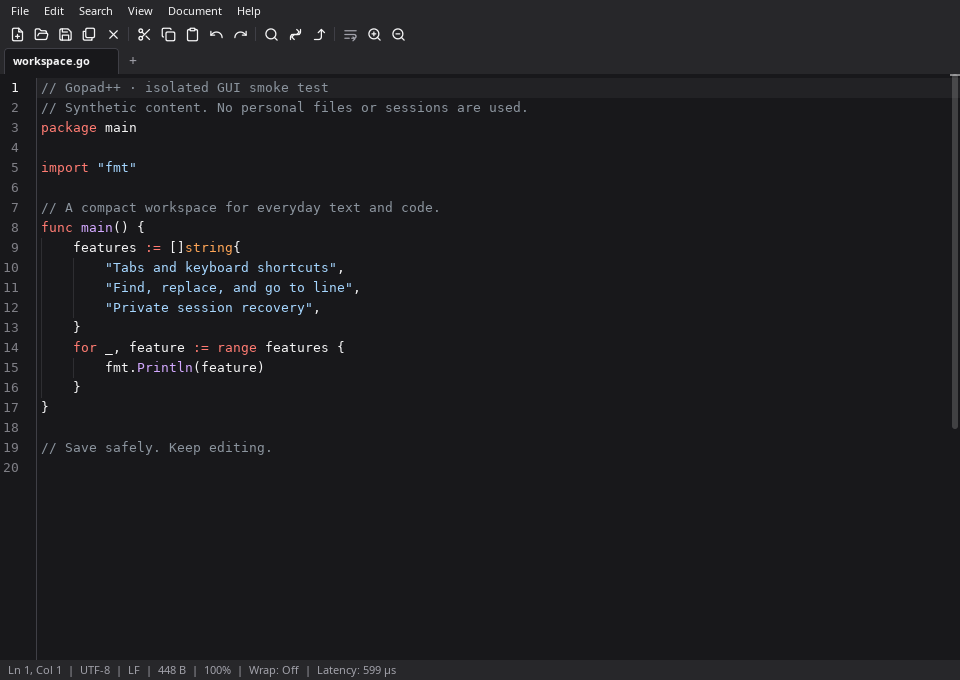
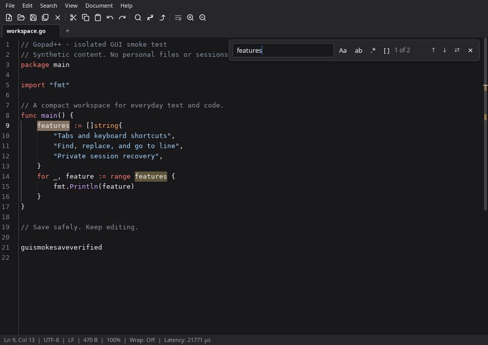
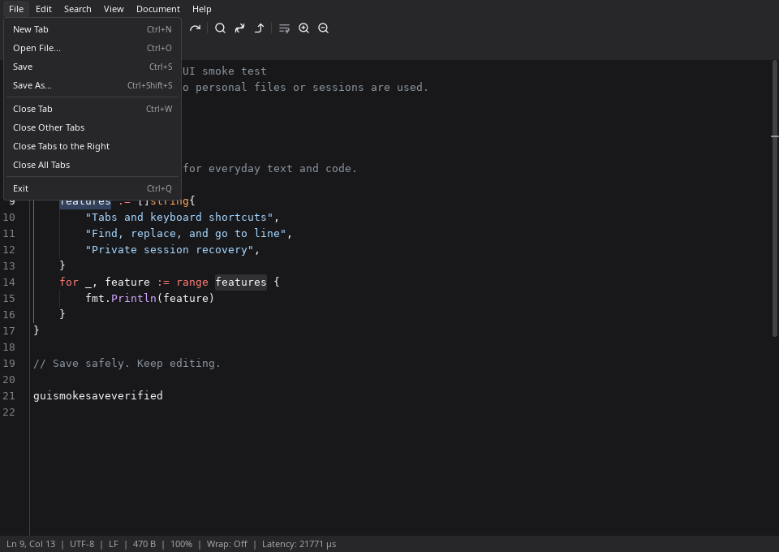

<p align="center">
  
</p>

# Gopad++

A compact native text editor for Linux, built in Go with [mygo/ui](https://github.com/egoist/mygo).
Tabs, keyboard shortcuts, find and replace, and session recovery in a small desktop workspace.
The editor draws through OpenGL; it does not use a webview.

**Development status:** early development. Recovery has regression coverage, but known
limitations remain. Read [release readiness](RELEASE_READINESS.md) before relying on a build
for important work. There is no stable release or guaranteed 120 FPS claim. The first
[pre-release, v0.1.0-rc.1](https://github.com/thanhnam2811/gpad/releases/tag/v0.1.0-rc.1),
is for evaluation and feedback.



[Light theme](assets/screenshots/editor-light.png) · [About and build identity](assets/screenshots/about-dark.png)

## What it does

- Edit multiple documents with dirty markers, syntax highlighting, line numbers, soft wrap and zoom.
- Find and replace, jump to a line, and navigate matches with the keyboard.
- Open large files in the background and search across CPU cores.
- Recover unsaved tabs through a private WAL and shadow drafts. Successful snapshots are fsynced;
  file replacement is staged beside the target and its directory is synced.
- Forward newly opened files to the running instance, keeping one workspace.
- Keep compact menus, toolbar and tabs above a 20 px status bar.

| Find and replace | Compact menus |
|---|---|
|  |  |

Screenshots are real captures from the isolated native X11 app using software OpenGL and
synthetic files, not mockups. Capture instructions and evidence are in
[release readiness](RELEASE_READINESS.md). Older recordings in `assets/` predate this polish.

## Build and run

Validated development host: **Ubuntu 24.04, Linux amd64**. GNOME Wayland and X11 are the
intended desktop environments; the current isolated graphical smoke tests use X11.
Linux arm64 builds are experimental cross-builds, without native runtime validation.
Windows and macOS are not supported by this application.

Use the Go version in [go.mod](go.mod), currently **Go 1.27.2**. On Ubuntu 24.04, runtime
libraries include GTK 3, GLib, Cairo, GDK Pixbuf, libepoxy and an OpenGL/EGL driver. A typical
base install is:

```sh
sudo apt-get install libgtk-3-0t64 libepoxy0 libgl1 libegl1
```

A working desktop/display and compatible graphics driver are also needed. Libraries are
loaded dynamically through purego; a build without cgo is still not a self-contained GUI runtime.

```sh
git clone https://github.com/thanhnam2811/gpad.git
cd gpad
go mod verify
mkdir -p bin
CGO_ENABLED=0 go build -o bin/gpad ./cmd/gpad
./bin/gpad
./bin/gpad notes.txt main.go
```

`./bin/gpad --version` reports build information; `--help` lists command-line options without
opening a window. Source builds identify themselves as development builds unless version
metadata is supplied by the release script.

## Install a local build

The release script creates a relocatable archive and checksum files. It does **not** publish
anything. See [release engineering](docs/RELEASING.md) for exact inputs and reproducibility checks.

```sh
VERSION=0.1.0-dev bash scripts/release.sh
bash scripts/verify-release.sh dist/gpad-0.1.0-dev-linux-amd64.tar.gz
mkdir -p /tmp/gpad-install
# Extract only an archive you built yourself or whose checksum you verified.
tar -xzf dist/gpad-0.1.0-dev-linux-amd64.tar.gz -C /tmp/gpad-install
PREFIX="$HOME/.local" bash /tmp/gpad-install/gpad-0.1.0-dev-linux-amd64/install.sh
```

Ensure `~/.local/bin` is on your desktop session's PATH. System packagers can use `PREFIX`
and `DESTDIR`; the installer includes the desktop entry, scalable/raster icons, AppStream
metadata and license texts. It does not change default file associations or remove session data.
An existing GPAD process continues running its old executable until you close and reopen it.
Uninstall removes only GPAD files under the chosen prefix; [instructions](docs/RELEASING.md#uninstall)
explicitly preserve your session and documents.

## Everyday use

| Action | Shortcut |
|---|---|
| New tab / open file | Ctrl+N / Ctrl+O |
| Save / save as | Ctrl+S / Ctrl+Shift+S |
| Close tab / quit | Ctrl+W / Ctrl+Q |
| Find / replace | Ctrl+F / Ctrl+H |
| Next / previous match | F3 / Shift+F3 |
| Go to line | Ctrl+G |

Menus show the bindings registered by the application. Session files currently live under
`~/.config/gpad/session`; do not delete them while GPAD is running. Reported persistence
errors appear in the status bar. Keep ordinary file backups as well as recovery snapshots.

## Reliability and performance

The [audit verification](AUDIT_VERIFICATION.md) records each previous finding, its evidence,
fix and regression test. The [performance journal](docs/perf-decisions.md) retains historical
measurements and their superseding decisions; numbers are specific to their hardware and harness.

There are important limits:

- Externally truncating a file while it is memory-mapped can cause Linux SIGBUS. Clean-file
  background search uses disk bytes, which may differ from the editor after external edits.
- Atomic save replaces an inode: ACLs, extended attributes, ownership and hard-link identity
  are not preserved. A post-rename sync error can mean the replacement happened but durability
  is uncertain.
- Fsync improves durability and costs latency. Synchronous session persistence can exceed the
  8.3 ms frame target; zero allocations per frame is also an unmet goal.
- Native arm64 execution, real power-cut recovery and compositor focus behavior are not
  established by headless tests.

## Development

```sh
go build ./...
go test ./...
go test -race ./...
go vet ./...
go mod verify
```

Use temporary documents and session directories for tests. For isolated native GUI QA:

```sh
# Ubuntu tooling: xvfb dbus-x11 x11-utils imagemagick libxtst6
python3 scripts/gui-smoke.py "$PWD/bin/gpad" /tmp/gpad-gui-evidence
```

The helper creates its own display, session bus, HOME and XDG directories. It never uses the
active Wayland display or the user's clipboard. Benchmark only relevant paths; record hardware,
flags, raw samples and variance. Mapping time alone is not the time needed to construct an editor
buffer. See [CONTRIBUTING.md](CONTRIBUTING.md) and [AGENTS.md](AGENTS.md) for review requirements.

## Project

- [Changelog](CHANGELOG.md) · [Roadmap](docs/roadmap.md) · [Release process](docs/RELEASING.md)
- [Branding and editable artwork](BRANDING.md) · [Security reporting](SECURITY.md)
- [Issues](https://github.com/thanhnam2811/gpad/issues) · [Contributing](CONTRIBUTING.md)

Gopad++ code and original artwork are [MIT licensed](LICENSE). The bundled mygo source
retains its own MIT license; [third-party notices](THIRD_PARTY_NOTICES.md), including
Feather/Lucide toolbar attribution, accompany release archives. AppStream metadata
is dedicated under CC0-1.0. This project is independent of Notepad++ and the Go project.
