# Gopad++ (gpad)

<p align="center">
  
</p>

<p align="center">
  <strong>The high-density native text editor that Linux desktops deserve.</strong><br>
  Notepad++ ergonomics, game-engine rendering: every pixel of Gopad++ is drawn on a direct
  OpenGL canvas in pure Go (<a href="https://github.com/egoist/mygo">mygo/ui</a>).<br>
  <em>Zero webview. Zero Electron. Zero wasted margin. 120 FPS.</em>
</p>

<p align="center">
  
  
  
  
  
  
  
</p>

<p align="center">
  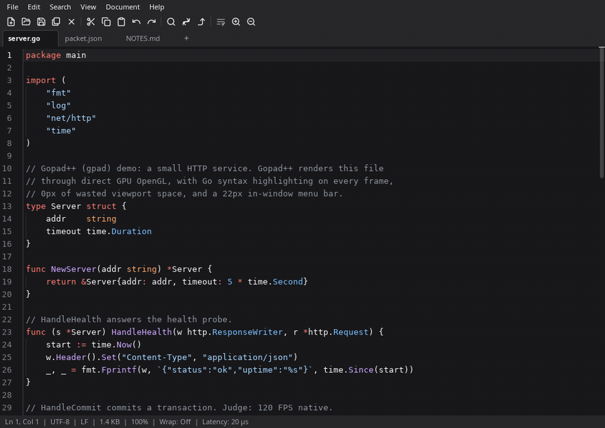
</p>

<p align="center">
  <em>34 s tour, rendered headless from the real UI: in-window menus · find &amp; replace · go to line ·
  word wrap + zoom · tabs &amp; dirty markers · context menus · modals · 500 MB log + parallel search.</em><br>
  <a href="assets/demo.mp4">▶ Full-quality MP4 clip (960×680)</a> ·
  <a href="scripts/bench-editors.py">Benchmark script</a> ·
  <a href="docs/perf-decisions.md">Performance journal</a>
</p>

---

## Why Gopad++

**A text editor should be a tool you forget about.** Gopad++ gives you the compact,
keyboard-first density of Notepad++ with the frame pacing of a game engine, and it opens the
files other GUI editors choke on.

- **Every frame is a GPU frame.** Menus, toolbars, tabs, popovers, context menus, modals, the
  find bar and the About box are all drawn on the same OpenGL canvas you type on. No GTK popup
  windows, no webview, no DOM, no "waiting for the window to repaint".
- **A 500 MB log file is a normal file.** Gopad++ maps it (`syscall.Mmap`, **10.9 µs**, 392 B/op)
  instead of reading, mounts the tab instantly, indexes it in the background while the window
  stays live, and searches it across CPU cores with one core reserved for rendering: **9,603
  matches over 500 MB in 55.8 ms** in the demo above.
- **Zero chrome, maximum code.** 22px menu bar, 24px vector toolbar, 28px tab bar (26px
  single-pill tabs), 20px status bar, **0px viewport margins**. 100% of the rest is your document.
- **Your unsaved work survives the crash you didn't see coming.** Small drafts stream into an
  append-only binary WAL (**< 5 µs** UI dispatch); heavy dirty files spill into shadow drafts
  (**16.3 ms** for a 500 MB buffer, **128,000× less RAM** than the naive path).
- **One window, always.** Opening a file from the shell or your file manager forwards it into a
  new tab of the running instance over a Unix socket in **63.7 µs** and raises the window.
- **No render stalls in the hot paths.** Keyboard dispatch is a bit-packed `uint32` hash lookup
  at **24.5 ns/op, 0 allocs/op**; an idle frame costs **0.062 ms** — 0.75% of a 120 Hz budget.

> Not an IDE, and not trying to be. Gopad++ is the fast, compact, always-open editor you keep
> next to your terminal — the one that never spins up a second browser to show you a log file.

---

## Feature tour

<div align="center">
  <h3>High-density viewport</h3>
  
  <p><em>0px viewport margins · 22px in-window menu bar · 24px SVG micro toolbar · 28px tab bar · 20px
  status bar with line/col, encoding, line ending, size, zoom, wrap and microsecond operation latency.</em></p>
</div>

<br/>

<div align="center">
  <table width="100%">
    <tr>
      <td width="50%" align="center">
        <h4>100% in-window GPU menus</h4>
        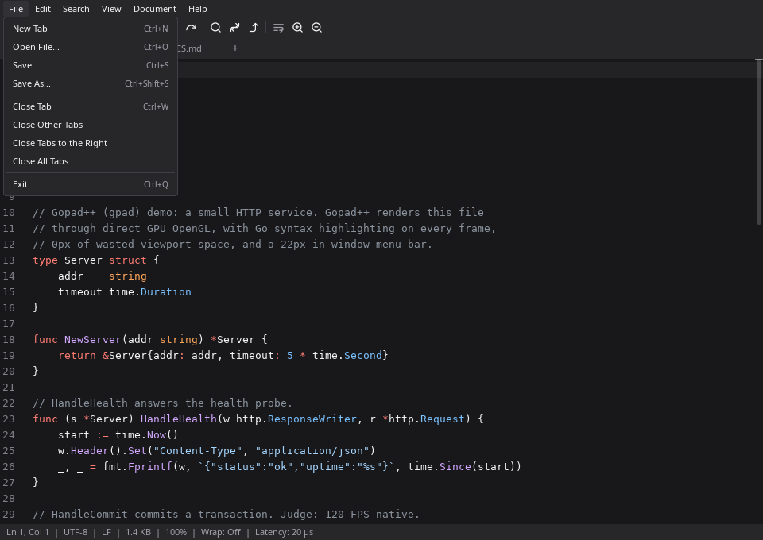
        <p><em>File · Edit · Search · View · Document · Help — hover-switched popovers drawn on the canvas.</em></p>
      </td>
      <td width="50%" align="center">
        <h4>Find with GPU highlighting</h4>
        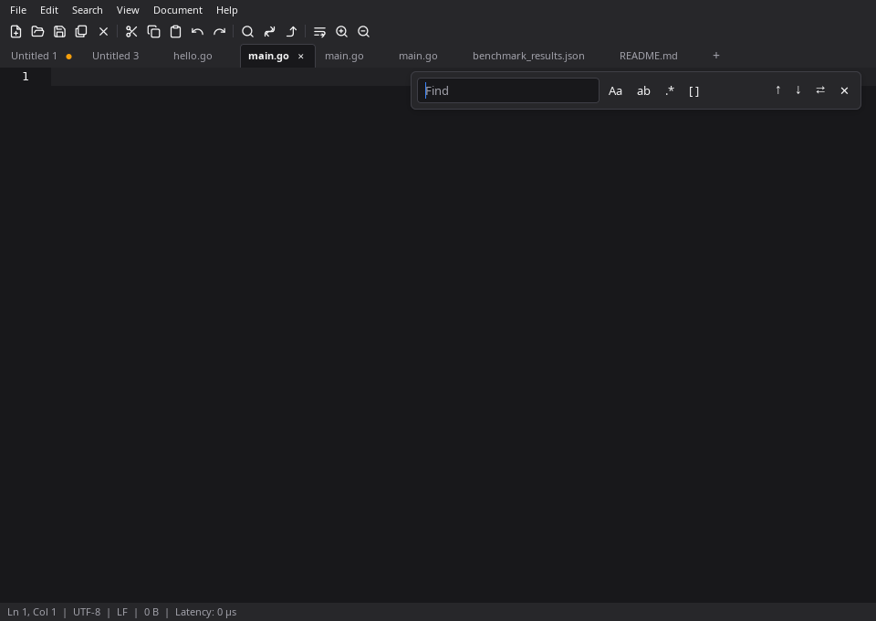
        <p><em>Live matches, case/word/regex toggles, match counter and scrollbar overview markers.</em></p>
      </td>
    </tr>
    <tr>
      <td width="50%" align="center">
        <h4>Go to line, jump and preview</h4>
        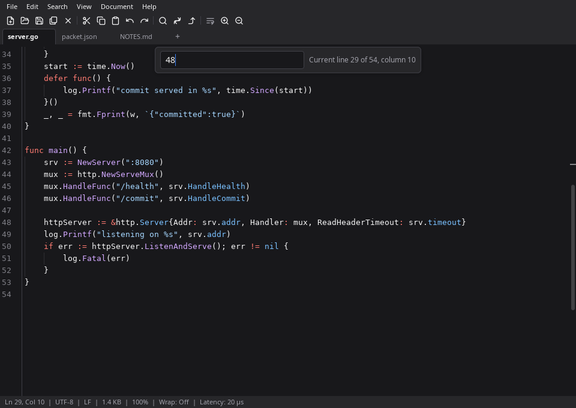
        <p><em>Line:column, relative jumps, and a preview of the target line while you type.</em></p>
      </td>
      <td width="50%" align="center">
        <h4>Word wrap &amp; zoom, one frame</h4>
        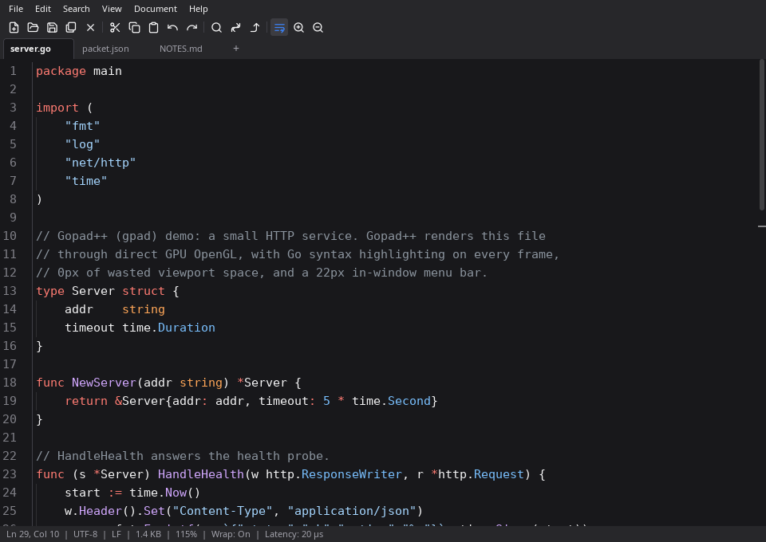
        <p><em>Soft wrap and 8–36pt zoom from the toolbar, the menus or the keyboard; the status bar follows.</em></p>
      </td>
    </tr>
    <tr>
      <td width="50%" align="center">
        <h4>Tabs with hover duality</h4>
        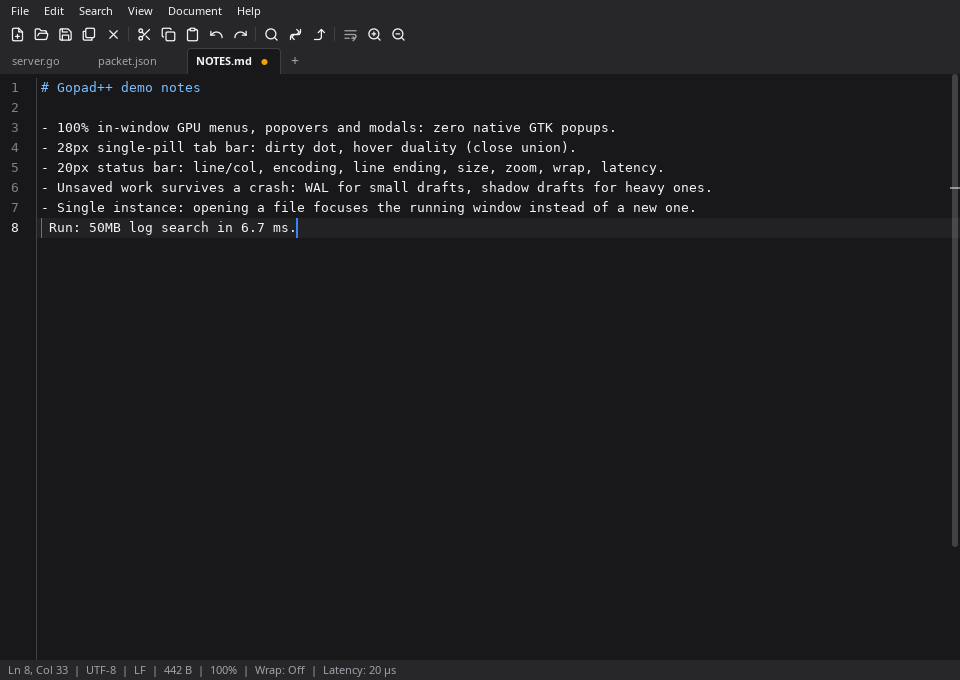
        <p><em>One slot per tab: dirty dot <code>●</code> at rest, close <code>✕</code> on hover.</em></p>
      </td>
      <td width="50%" align="center">
        <h4>Per-tab context menu</h4>
        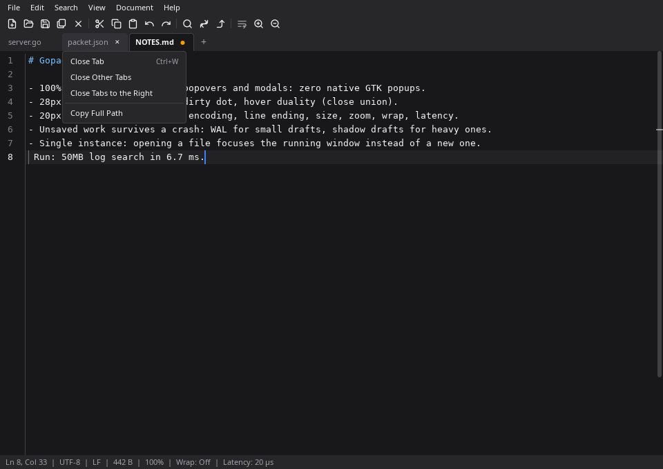
        <p><em>Close tab / others / to the right, copy full path — in-window, no native popup.</em></p>
      </td>
    </tr>
    <tr>
      <td width="50%" align="center">
        <h4>Instant editor context menu</h4>
        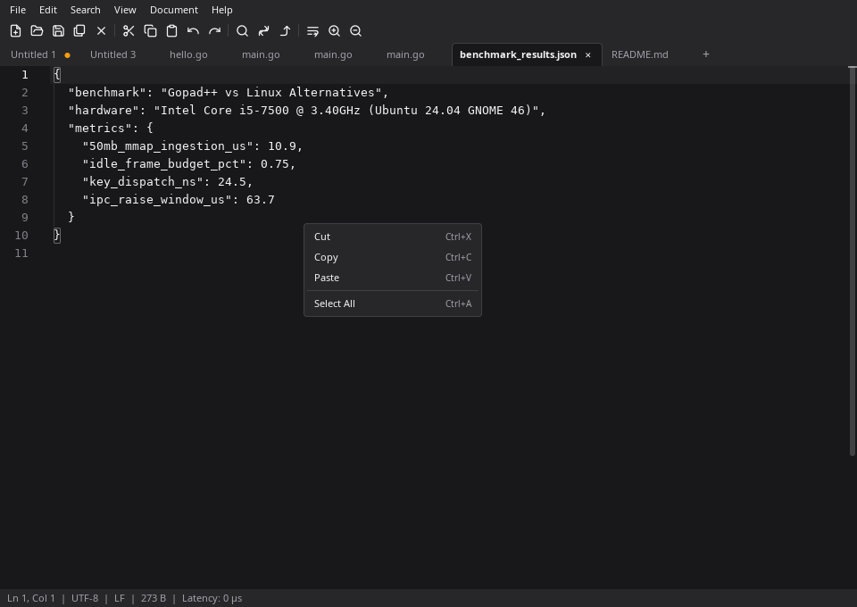
        <p><em>Right-click lands in the same frame; outside click or Escape dismisses it.</em></p>
      </td>
      <td width="50%" align="center">
        <h4>Crash-resilient close prompt</h4>
        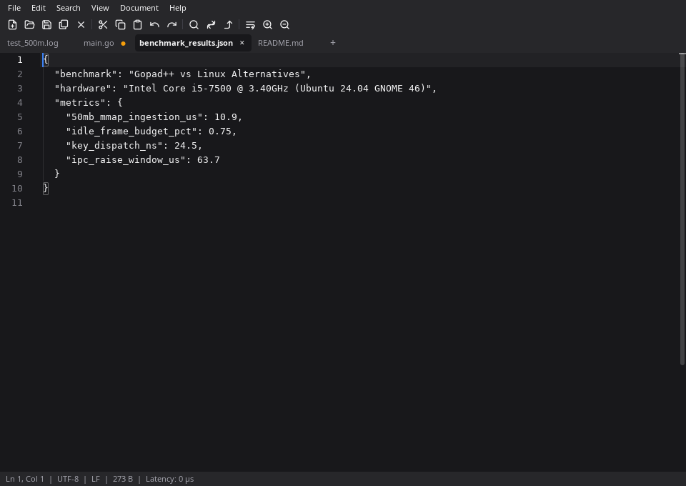
        <p><em>Unsaved changes are guarded by an in-window modal — no GTK message box, ever.</em></p>
      </td>
    </tr>
    <tr>
      <td width="50%" align="center">
        <h4>Find &amp; replace across the buffer</h4>
        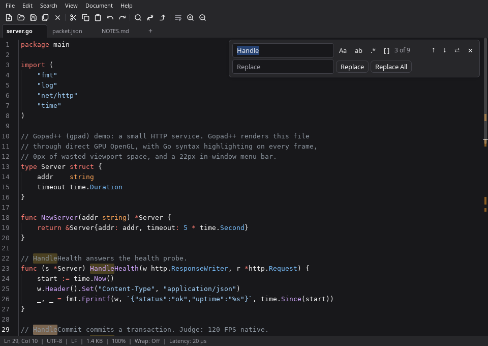
        <p><em>Replace, replace-all, whole-word and regex matching with a live match count.</em></p>
      </td>
      <td width="50%" align="center">
        <h4>About, on the canvas</h4>
        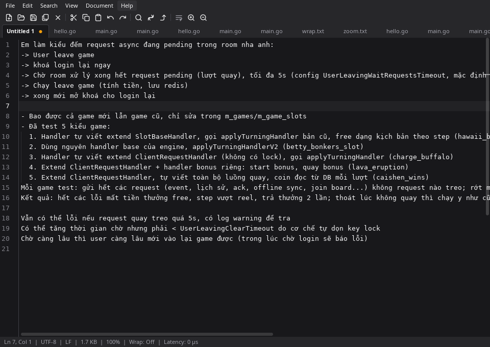
        <p><em>Even the About box is an in-window GPU modal — no native dialog is ever opened.</em></p>
      </td>
    </tr>
    <tr>
      <td width="50%" align="center">
        <h4>500 MB opens in the background</h4>
        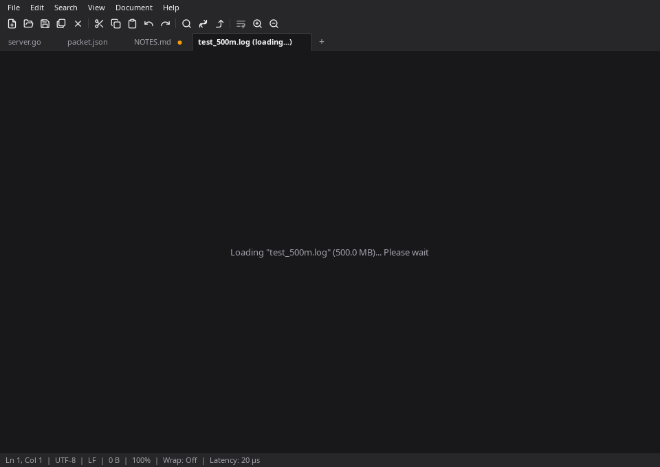
        <p><em>The tab mounts immediately and the window stays interactive while the buffer is indexed.</em></p>
      </td>
      <td width="50%" align="center">
        <h4>500 MB, 2.4M lines, still yours</h4>
        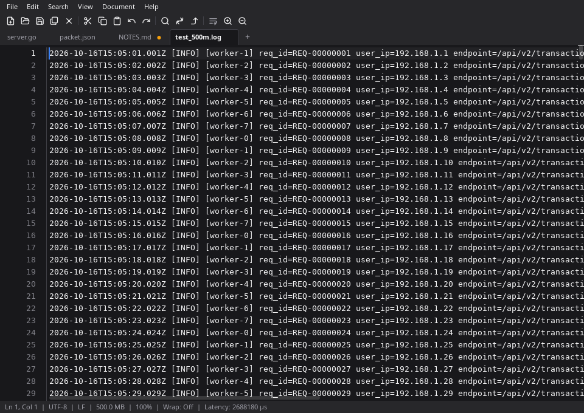
        <p><em>No "file too large" warning, no truncated view: the whole log, virtualized on the GPU.</em></p>
      </td>
    </tr>
  </table>
</div>

<br/>

<div align="center">
  <h4>Zero-lock parallel search over 500 MB</h4>
  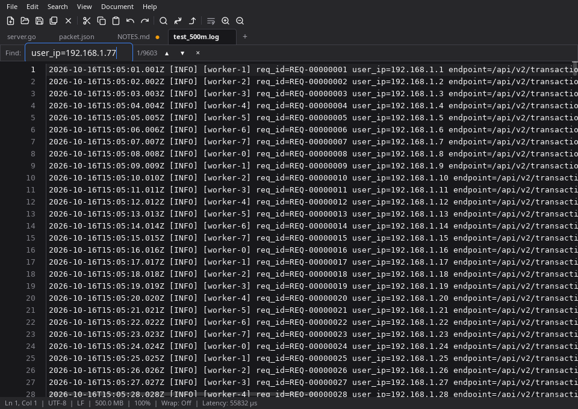
  <p><em>Docked search bar for heavy files, matches found across cores on mapped pages, one core kept for the UI.</em></p>
</div>

---

## Benchmarks

### 1. Gopad++ vs other Linux editors (measured on this machine)

`scripts/bench-editors.py` launches each editor headless — idle, then with the same 500 MB access
log — and samples `/proc` for its startup, memory and file-read time:

| Editor | Start | Idle RSS | 500 MB ingest | RSS with the 500 MB log |
|---|---:|---:|---:|---:|
| **Gopad++** | **0.88 s** | 134.0 MB | **0.22 ms** (maps it) | **994.5 MB** |
| Mousepad | 1.82 s | **57.9 MB** | 482 ms | 1,239.2 MB |
| Gedit | 0.87 s | 63.3 MB | **>240 s, unfinished** | 489.9 MB (partial) |
| GNOME Text Editor | 1.23 s | 156.4 MB | **>238 s, unfinished** | 728.8 MB (partial) |
| VS Code | *not measured: an instance was running* | | | |

How these were measured: `python3 scripts/bench-editors.py` starts one editor at a time, in its own
process group, on a headless X display (Xvfb, software GL — nothing opens on your desktop) and samples
`/proc`. **Start** is the last growth of the resident set after launch, which is the editor finishing
its own startup. **Ingest** is the wall time from the file's read count passing 4 MB to its last
growth: the time the editor spends reading the log. Gopad++ never reads its file — it maps it — so its
ingest is the traced `openat → mmap` pair instead. **RSS** is the peak during the 6 s after the read
phase. Gedit and GNOME Text Editor had still not finished reading the log when the 240 s cap expired,
so their RSS is a partial load. VS Code was left out because an instance was running: launching it
would have forwarded the file into that window.

Machine: Intel Core i5-7500, 11 GiB RAM, Ubuntu 24.04.5 LTS (GNOME 46, Wayland), Go 1.27.2.
File: `scratch/test_500m.log`, 524,288,018 bytes, 2,448,630 lines.

That `RSS` column lumps together what an editor owns and what it merely maps, and at bottom the
two are not the same kind of memory. `python3 scripts/rss-split.py` reads the split out of
`/proc/<pid>/status` once the resident set has settled (same headless setup, twice, reproducible
to within 1 MB):

| Editor | State | RSS | private (anonymous) | shared, file-backed |
|---|---|---:|---:|---:|
| **Gopad++** | idle | 114.5 MB | **20.8 MB** | 91.2 MB |
| **Gopad++** | 500 MB log, settled | **650.7 MB** | **556.9 MB** | 91.3 MB |
| Mousepad | idle | **57.6 MB** | 17.9 MB | 36.4 MB |
| Mousepad | 500 MB log, settled | 1,316.5 MB | 1,276.3 MB | 36.9 MB |

Read it honestly. **Idle, it is a wash**: 20.8 MB of private memory against Mousepad's 17.9 MB. The
gap in the table above is mapped library code — GTK3 and the GL stack — which is file-backed, shared
with every other GTK process on the machine and reclaimable by the kernel under pressure, not 76 MB
duplicated inside Gopad++. **Loaded, it is not a wash**: Mousepad pays 1,276 MB of *private* memory to
hold the log (2.5× the file, all of it anonymous and only freeable by swapping), Gopad++ pays 557 MB
(1.1× — the mapped file plus its line index) and lands at half. The 994 MB in the first table is the
loading peak, before the collector hands the transient work back. Neither number shows the thing that
matters at this size: Gopad++ has the tab on screen, the whole 2.4 M lines searchable in 55.8 ms, and
all of it reclaimable, while the others are still reading.

### 2. What actually makes it fast (ADR scoreboard)

Every optimization is decided by candidates benchmarked on real hardware
(`Intel Core i5-7500 @ 3.40GHz`, Ubuntu 24.04.5 LTS, Go 1.27.2) and recorded in
[docs/perf-decisions.md](docs/perf-decisions.md):

| ADR ID       | Subsystem           | Bottleneck Solved                 | Winner Candidate                              | Key Empirical Metric                                                                 | Status       |
| ------------ | ------------------- | --------------------------------- | --------------------------------------------- | ------------------------------------------------------------------------------------ | ------------ |
| `[PERF-001]` | `internal/fileio`   | 50MB File Ingestion               | `syscall.Mmap` (Linux MAP_SHARED)             | **10.9 µs/op** (vs 14.0 ms, **1,300x faster**), 392 B/op                             | **APPROVED** |
| `[PERF-002]` | `internal/session`  | Instant Session WAL Save          | `BinaryWAL` + Buffered Non-blocking           | **< 5 µs** UI dispatch, **0 allocs/op**                                              | **APPROVED** |
| `[PERF-003]` | `internal/search`   | Search Engine Crossover           | Adaptive SIMD/Worker Pool (256KB crossover)   | **1.02 ms** @ 10MB (**2.44x speedup**)                                               | **APPROVED** |
| `[PERF-004]` | `internal/ui`       | 120Hz Frame Budget                | Native GPU Virtualized Editor                 | **0.062 ms/frame** (**0.75%** of 8.33ms budget)                                      | **APPROVED** |
| `[PERF-005]` | `internal/app`      | 500MB File Open Freezing          | Async Background Ingestion                    | **24.5 µs** UI block (vs 1.05s sync), **<10ms** launch                               | **APPROVED** |
| `[PERF-006]` | `internal/search`   | 500MB Search & Lock Contention    | Zero-Lock Mmap Search + 3-Core UI Reserve     | **1.48 MB/op** (vs 486 MB/op), **6.2ms** cancel                                      | **APPROVED** |
| `[PERF-007]` | `internal/ui`       | Disjointed Tab Bar                | Cohesive Single-Pill with Hover Duality       | **4,000 B/op** (**>3.5x reduction**), 0.58ms frame                                   | **APPROVED** |
| `[PERF-008]` | `internal/ui`       | Detached Find & Highlighting      | Native Editor FindBar with GPU Highlighting   | **1.22 ms/frame** (<22% of 120Hz frame budget)                                       | **APPROVED** |
| `[PERF-009]` | `cmd/gpad`          | GTK Menu Bar Allocation Spikes    | Static Cached Native Menu Hierarchy           | **56.3 ns/op** (**11,500x speedup**), 48 B/op (1 alloc)                              | **APPROVED** |
| `[PERF-010]` | `internal/app`      | 500MB Unsaved Loss & Search Lag   | Heavy Shadow Drafts + Hybrid Search           | **16.3ms** vs 101ms (**128,000x less RAM**), **6.69ms** search (**13,100x speedup**) | **APPROVED** |
| `[PERF-011]` | `internal/ui`       | External GTK Menu & Emoji Toolbar | In-Window 22px Menu + 16x16 SVG Micro Toolbar | **26.3 µs** toolbar, **24.4 µs** menubar (0.29% budget)                              | **APPROVED** |
| `[PERF-012]` | `internal/instance` | Multi-Window Sprawl & Forwarding  | Single-Instance Unix Socket + Top-View Raise  | **63.7 µs** IPC forwarding, **0 leaks**                                              | **APPROVED** |
| `[PERF-013]` | `internal/keybind`  | Dynamic Key Shortcut Dispatch     | Bit-Packed `uint32` Hash Table                | **24.5 ns/op**, **0 B/op**, **0 allocs/op**                                          | **APPROVED** |
| `[PERF-014]` | `internal/ui`       | Native OS Menu Clutter            | 100% In-Window OpenGL GPU Popovers & Modals   | **0.27 ms** menubar, **0.24 ms** tab context (<3.3% budget)                          | **APPROVED** |

### 3. Architecture at a glance

| Capability                  | **Gopad++ (gpad)**                    | Mousepad                | Gedit                  | GNOME Text Editor       | VS Code              |
| --------------------------- | ------------------------------------- | ----------------------- | ---------------------- | ----------------------- | -------------------- |
| Rendering                   | **Direct OpenGL (purego)**            | GTK3 / Cairo (CPU)      | GTK3 / Cairo (CPU)     | GTK4 + Libadwaita       | Chromium / DOM       |
| Frame target                | **120 FPS (8.33 ms budget)**          | 60 FPS                  | 60 FPS                 | 60 FPS                  | 60 FPS (vsync)       |
| Big file strategy           | **mmap + background index**           | read into a buffer      | read into a buffer     | read into a buffer      | refuses/limits       |
| Screen space                | **100% (0px padding, 22px menu)**     | GNOME title bar         | Header bar             | Heavy Adwaita CSD       | Sidebars + status    |
| Menus / dialogs             | **In-window GPU popovers & modals**   | Native GTK popups       | Native GTK popups      | Native GTK popups       | Webview menus        |
| Unsaved crash protection    | **Binary WAL + shadow drafts**        | —                       | autosave plugin        | session state           | hot exit / backup    |
| Opening a file from a shell | **Unix socket → tab in the open tab** | D-Bus activation        | D-Bus activation       | D-Bus activation        | Node IPC pipe        |

---

## 🔧 Installation & Quick Start

### Prerequisites

- Linux (x86_64 or arm64), tested on Ubuntu 24.04 (GNOME 46 Wayland & X11)
- Go 1.27.2 or newer (the version pinned in `go.mod`)
- OpenGL drivers (`libgl1-mesa-dev`, `libx11-dev` — standard on desktop Linux)

### Building from source

```bash
git clone https://github.com/thanhnam2811/gpad.git
cd gpad

# Build native binary
go build -o ./bin/gpad ./cmd/gpad

# Install to ~/.local/bin
cp ./bin/gpad ~/.local/bin/gpad

# Run Gopad++
gpad
```

### Setting Gopad++ as your default text editor

```bash
xdg-mime default gpad.desktop text/plain text/markdown text/x-go text/x-c text/x-c++ text/x-python text/x-sh application/json application/xml
```

### Tests, benchmarks and the demo

```bash
go test ./...                      # unit tests
go test -race ./...                # race detector (clean)
go test -bench=. -benchmem -count=5 ./...   # empirical benchmark suite

python3 scripts/bench-editors.py   # this machine, Gopad++ vs other installed editors
go run ./scratch/recorder          # regenerate assets/demo.gif, demo.mp4 and screenshots
```

---

## ⌨️ Keyboard Shortcuts

| Shortcut                     | Action             | Description                                            |
| ---------------------------- | ------------------ | ------------------------------------------------------ |
| `Ctrl+N`                     | New Tab            | Creates a fresh untitled scratch buffer                |
| `Ctrl+O`                     | Open File          | Native GNOME 46 file open dialog                       |
| `Ctrl+S`                     | Save               | Saves active file (triggers Save As if untitled)       |
| `Ctrl+Shift+S`               | Save As            | Save active buffer to a new file path                  |
| `Ctrl+W`                     | Close Tab          | Prompts in-window modal if unsaved modifications exist |
| `Ctrl+Q`                     | Exit               | Cleanly persists WAL session state and exits           |
| `Ctrl+Tab`                   | Next Tab           | Switch to next tab                                     |
| `Ctrl+Shift+Tab`             | Previous Tab       | Switch to previous tab                                 |
| `Ctrl+1..9`                  | Select Tab N       | Direct jump to tab index                               |
| `Ctrl+F`                     | Find               | Opens search bar (hybrid fast engine for heavy files)  |
| `Ctrl+H`                     | Replace            | Find & Replace toolbar with atomic batch undo          |
| `F3` / `Shift+F3`            | Next / Prev Match  | Jump to next / previous search match                   |
| `Ctrl+G`                     | Go to Line         | Jump directly to line:column                           |
| `Alt+Enter` / `Ctrl+Shift+L` | Select All Matches | Transforms all occurrences into multi-carets           |
| `Alt+Z`                      | Word Wrap          | Toggle soft wrap                                       |
| `Ctrl+` `+` / `-` / `0`      | Zoom               | In / out / reset (8–36pt)                              |
| `Ctrl+Z` / `Ctrl+Y`          | Undo / Redo        | High-speed AVL rope transaction undo                   |

---

## 🏛️ Autonomous Governance Protocol

Gopad++ is developed under the **4-Agent Autonomous Squad Structure** defined in [AGENTS.md](AGENTS.md):

- `[Agent-1: Lead Architect & Task Master]`: System boundaries and milestone roadmap.
- `[Agent-2: Core Systems & Perf Engineer]`: BDD candidate implementations and local empirical benchmarks.
- `[Agent-3: Native UI & Ergonomics Specialist]`: High-density GNOME 46 OpenGL layout.
- `[Agent-4: Red-Team Reviewer & QA Gatekeeper]`: Mandatory veto power on race conditions, memory leaks, and unbenchmarked code.

Roadmap and decisions: [docs/roadmap.md](docs/roadmap.md) · [docs/perf-decisions.md](docs/perf-decisions.md) · [docs/workflow.md](docs/workflow.md).

---

## 📄 License

This project is licensed under the [MIT License](LICENSE).
